# ⚡ Attractor — DOT-Based Agentic Software Factory Engine


**Attractor** is a complete, production-grade implementation of the [StrongDM Attractor Specification](./attractor-spec.md): a declarative, **Graphviz DOT-driven multi-agent software factory** with a 5-step deterministic edge router, goal gates, exponential backoff retry policies, human-in-the-loop (HITL) interviewer stations, stylesheet/variable graph transforms, and an interactive **FastAPI + SSE Operator Console**.

---

## 🏛️ Architecture Overview

```mermaid
flowchart LR
    DOT["Declarative Graphviz DOT<br/>Pipeline Definition"] --> Parser["DOT Parser & AST<br/>(parser.py)"]
    Parser --> Transforms["Graph Transforms<br/>• Variable Expansion ($goal)<br/>• CSS-like Model Stylesheets"]
    Transforms --> Validator["Static Lint & Validator<br/>(validator.py)"]
    Validator --> Runner["Pipeline Execution Engine<br/>(engine.py)"]

    subgraph Handlers ["Stage Node Handlers (handlers.py)"]
        H1["Mdiamond: Start"]
        H2["box: Codergen LLM Agent"]
        H3["hexagon: Wait.Human Interviewer"]
        H4["diamond: Conditional Router"]
        H5["component: Parallel Fan-Out"]
        H6["Msquare: Terminal Exit"]
    end

    Runner --> Handlers
    Handlers --> EdgeSelect["5-Step Deterministic Edge Selector<br/>& Goal Gate Enforcer"]
    EdgeSelect --> Checkpointer["Durable Stage Artifacts &<br/>checkpoint.json"]
    Runner -->|Real-Time SSE Events| Console["FastAPI Operator Console<br/>(api.py + static/index.html)"]
```



---

## ✨ Key Capabilities Implemented

1. **Full Graphviz DOT Parser & AST (`src/attractor/parser.py`)**:
   - Parses `digraph` definitions, graph/node/edge default blocks, chained edges (`A -> B -> C`), subgraphs, and typed attributes (`shape`, `goal_gate`, `max_retries`, `retry_target`, `llm_model`, `condition`, `weight`).
2. **Static Graph Validation (`src/attractor/validator.py`)**:
   - Enforces single-entry `Mdiamond` start nodes, reachable `Msquare` terminal nodes, valid condition syntax (`=`, `!=`, `&&`), and cycle/orphan diagnostics before execution begins.
3. **5-Step Deterministic Edge Selection (`src/attractor/engine.py`)**:
   - Evaluates outgoing transitions deterministically: (1) Condition-matching edges (`outcome=success && context.tests_passed=true`), (2) `preferred_label` match, (3) `suggested_next_ids`, (4) Edge `weight` priority, and (5) Lexical tie-breaking.
4. **Goal Gates & Self-Healing Retries**:
   - Enforces `goal_gate=true` nodes before allowing terminal exit, automatically rerouting to `retry_target` or `fallback_retry_target` with configurable exponential backoff and jitter.
5. **Human-in-the-Loop Interviewer (`src/attractor/interviewer.py`)**:
   - Supports `AutoApproveInterviewer`, `QueueInterviewer`, `CallbackInterviewer`, and `WebInteractiveInterviewer` for live browser-based human approvals on `hexagon` (`wait.human`) nodes.
6. **Real-Time FastAPI Server & Operator Console (`src/attractor/api.py`)**:
   - Exposes REST & SSE endpoints (`/pipelines`, `/pipelines/{id}/events`, `/pipelines/{id}/questions`, `/pipelines/{id}/answer`, `/validate`, `/presets`) and serves a live DAG visual operator console.

---

## 🚀 Quickstart

### 1. Install Dependencies & Run Tests
```bash
uv sync --all-extras
uv run pytest -v
```

### 2. Launch the Interactive Software Factory Console
```bash
uv run uvicorn attractor.api:app --reload --port 8000
```
Open **`http://localhost:8000`** to inspect preset software factory pipelines, validate custom DOT graphs, stream live stage transitions via SSE, and approve human-in-the-loop gates.

### 3. Run the MCP Server & Pipeline Visualizer
```bash
# Run stdio MCP server for Claude Desktop / Gateway integration
uv run python -m attractor.mcp_server

# Available MCP tools:
# - attractor_lint_pipeline: Validate DOT source against 13 spec rules
# - attractor_run_pipeline: Execute factory pipeline on workspace
# - attractor_list_presets: List factory templates
# - attractor_parse_graph: Inspect AST representation
# - attractor_export_diagram: Render Mermaid or terminal ASCII flowchart
```

---

## 📚 Natural Language Specifications (NLSpecs)

- [Attractor Pipeline Specification](./attractor-spec.md)
- [Coding Agent Loop Specification](./coding-agent-loop-spec.md)
- [Unified LLM Client Specification](./unified-llm-spec.md)
